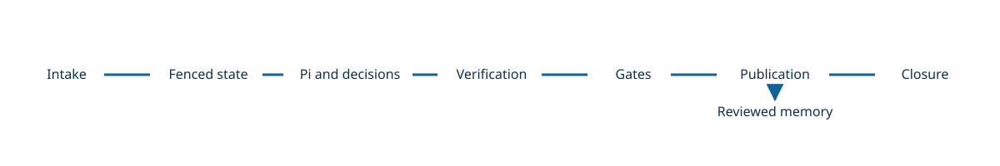

# Loopwright

[](./LICENSE)
[](./docs/README.md)


Loopwright runs bounded repository work with independent verification and authenticated publication. A GitHub App control plane, reusable GitHub Action, and local CLI provide entry points.

Read the [architecture overview](./docs/getting-started/architecture.md) and [documentation](./docs/README.md) for authority and qualification boundaries.

## Architecture


<!-- flowchart LR
  Admit["1. Admit"] -> Execute["2. Execute"] -> Verify["3. Verify"] -> Publish["4. Publish & Remember"]
-->

1. **Admit**: [Validate intake](./docs/contribute/github-app-internals.md) and reserve a [lease fence](./docs/contribute/state.md).
2. **Execute**: Run an isolated [Pi adapter](./docs/contribute/pi-adapter.md) under bounded authority.
3. **Verify**: Bind [independent evidence](./docs/contribute/evidence.md) to the candidate.
4. **Publish & Remember**: Reconcile publication and propose [reviewed memory](./docs/contribute/memory.md).

## Highlights

- **Non-delegable verification**: Trusted gates issue authenticated receipts; model output cannot certify its own work. See [evidence](./docs/contribute/evidence.md).
- **Sandboxed execution**: Native and container backends negotiate required isolation and fail closed when unavailable. See [Sandbox Backends](./docs/configuration/sandbox-backends.md).
- **Fenced state**: Lease fences, clock guards, and retained reservations protect recovery. Unknown external outcomes require reconciliation. See [state](./docs/contribute/state.md).
- **Advisory decisions**: Optional System-One routing uses confidence thresholds and deterministic fallbacks. See [Decision Routing](./docs/configuration/decision-routing.md).
- **Declarative taskpacks**: Define repository scope, triggers, checks, and publication in YAML. See [Declarative Taskpack](./docs/walkthroughs/declarative-taskpack.md).
- **Reviewed memory**: Content-addressed proposals apply separately after review. See [memory](./docs/contribute/memory.md).
- **Capability closure**: Inspect local evidence and external prerequisites with the [closure matrix](./docs/contribute/closure-matrix.md).

## Features

The App, Action, and CLI share bounded contracts and evidence. The [closure matrix](./docs/contribute/closure-matrix.md) records supported paths and external gaps.

## Quick Start

Loopwright offers **two operating modes** sharing one verification kernel:

1. **Declarative Taskpack Mode (Simple Automation)**: Add `.loopwright/taskpack.yaml` + `uses: gpustack/loopwright@main` in your repository; Loopwright compiles contracts, handler SHA-256 digests, and secret bindings automatically. Follow [Declarative Taskpack](./docs/walkthroughs/declarative-taskpack.md) and [Taskpack](./docs/configuration/taskpack.md).
2. **Managed Controller Mode (Fine-Grained Governance)**: Maintain an out-of-repo `TrustedRegistry` (`registry.yaml`) and SHA-256-pinned `ControllerConfig` (`controller.yaml`) via the `@gpustack/loopwright` CLI. Follow [Managed Controller](./docs/walkthroughs/managed-controller.md).

### Bootstrap or Migrate in One Prompt (`llms.txt`)

No custom skill is required. Open any coding agent inside your repository (for example, to migrate an existing automatic synchronized workflow) and paste:

```text
Read https://docs.gpustack.ai/loopwright/llms.txt and fetch the Markdown guides for Declarative Taskpack, Taskpack, and GitHub Action. Inspect this repository (including existing automatic synchronized workflows, scripts, version tables, and directory layout), confirm my upstream sources, writable/protected scope, verification checks, and PR settings with me, then generate .loopwright/taskpack.yaml and .github/workflows/loopwright.yml (apiVersion: loopwright.dev/v1alpha1) without hardcoding secrets.
```

### Install the Laptop CLI

To run Managed Controller cycles or repository audits locally (requires the [runtime baseline](./docs/getting-started/architecture.md#runtime-baseline); see [Installation](./docs/getting-started/installation.md)):

```sh
npm install -g --ignore-scripts @gpustack/loopwright
# or: pnpm add -g --ignore-scripts @gpustack/loopwright
loopwright init --directory "$HOME/loopwright-config"
loopwright check --config CONFIG --registry REGISTRY --registry-sha256 DIGEST
```

For workspace development and repository closure verification:

```sh
git clone https://github.com/gpustack/loopwright.git
cd loopwright
npm ci && npm run build
node packages/cli/dist/main.js closure --verify-failures
```

Replace draft placeholders with approved configuration before running `check` (or use the [Managed Controller prompt](./docs/getting-started/installation.md#prompt-bootstrap)). Static checks do not establish execution readiness. See [CLI](./docs/operations/cli.md).

## Usage

### Automated Upstream Sync


<!-- flowchart LR
  A["Upstream"] -> B["Taskpack"] -> C["Verification"] -> D["Pull request"]
-->

Save this complete manifest as `.loopwright/taskpack.yaml`:

```yaml
apiVersion: loopwright.dev/v1alpha1
kind: Taskpack
metadata:
  name: docs-sync
spec:
  goal:
    candidate: Refresh documentation from upstream sources and pass every local check.
    noChange: Confirm the documentation needs no change and settle as no change.
  scope:
    writable:
      - docs
    protected:
      - policy/protected-notes.md
  upstreams:
    - id: engine
      kind: github-release
      source: octocat/engine
      watchedPaths:
        - docs
  proposal:
    path: docs/proposal.json
    requiredFields:
      - schema_version
      - candidates
    schemaVersion: 1
  verification:
    localChecks:
      - id: docs-proposal-json
        implementation: json-artifact.v1
    externalGates: []
  publication:
    mode: pull_request
    targetBranch: main
    headBranchPrefix: loopwright-docs-
    titleTemplate: 'docs: sync upstream documentation'
  memory:
    directory: .loopwright/memory/docs-sync
    apply: separate-pull-request
    onNoModelBudget: deterministic-observations-only
  triggers:
    schedule: true
    workflowDispatch: true
    releasePublished: false
    commentCommands:
      - retry
      - revise
      - status
  sandbox:
    preferredBackends:
      - macos-seatbelt
      - linux-bwrap
      - linux-landlock
      - docker
    networkMode: none
    requiredCapabilities:
      - filesystemReadContainment
      - filesystemWriteContainment
      - protectedPathReadOnlyMask
      - networkIsolation
      - processTreeCleanup
    deniedReadPaths:
      - ~/.ssh
```

- **Scope**: Keep writable and protected paths separate; place memory outside writable scope.
- **Host**: Supply trusted bindings and qualified gate and publication services separately.
- **Triggers**: An upstream declaration does not itself install a scheduler or webhook.

See [Declarative Taskpack](./docs/walkthroughs/declarative-taskpack.md).

### Slash-Command Maintenance


<!-- flowchart LR
  A["Comment"] -> B["Webhook"] -> C["Dispatch"] -> D["Status"]
-->

A GitHub App supplies a scoped installation token to the consumer workflow. Register the App and store its credentials as described in [GitHub App](./docs/operations/github-app.md).

A consumer repository can declare this workflow to receive `/loopwright retry` and `/loopwright status` events:

```yaml
name: loopwright
on:
  schedule:
    - cron: '0 3 * * *'
  workflow_dispatch: {}
  issue_comment:
    types: [created]
permissions:
  contents: read
jobs:
  taskpack:
    runs-on: ubuntu-latest
    steps:
      - uses: actions/checkout@v4
      - uses: actions/create-github-app-token@v1
        id: app-token
        with:
          app-id: ${{ secrets.LOOPWRIGHT_APP_ID }}
          private-key: ${{ secrets.LOOPWRIGHT_APP_PRIVATE_KEY }}
      - uses: gpustack/loopwright@main # Pin a reviewed immutable revision.
        id: loopwright
        with:
          taskpack-path: .loopwright/taskpack.yaml
          event-name: ${{ github.event_name }}
          event-path: ${{ github.event_path }}
          dry-run: 'true'
        env:
          GH_TOKEN: ${{ steps.app-token.outputs.token }}
          LOOPWRIGHT_PROVIDER_TOKEN: ${{ secrets.LOOPWRIGHT_PROVIDER_TOKEN }}
          LOOPWRIGHT_GATE_SIGNING_SECRET: ${{ secrets.LOOPWRIGHT_GATE_SIGNING_SECRET }}
          LOOPWRIGHT_PUBLICATION_SIGNING_SECRET: ${{ secrets.LOOPWRIGHT_PUBLICATION_SIGNING_SECRET }}
```

- **Authorization**: Configure comment commands in the taskpack and authorize the actor.
- **Credentials**: `compileDeclarativeTaskpack` binds `${LOOPWRIGHT_PROVIDER_TOKEN}`, `${LOOPWRIGHT_GATE_SIGNING_SECRET}`, and `${LOOPWRIGHT_PUBLICATION_SIGNING_SECRET}` as unexpanded templates on disk and resolves them in memory during controller execution.
- **Dry-run**: `dry-run: 'true'` compiles and validates artifacts outside the checkout; live execution requires a wired host controller delegate.

| Variable | Consumer | Purpose |
| --- | --- | --- |
| `GH_TOKEN` | GitHub API | Short-lived installation token from `actions/create-github-app-token@v1` |
| `LOOPWRIGHT_PROVIDER_TOKEN` | `provider` | Authenticates the isolated Pi authoring role against the model provider |
| `LOOPWRIGHT_GATE_SIGNING_SECRET` | `gate` | Signs external `gate.v1` requests and verifies HMAC verdict receipts |
| `LOOPWRIGHT_PUBLICATION_SIGNING_SECRET` | `publisher` | Signs PR publication dispatches and verifies publication receipts |

See [Action secrets and environment](./docs/operations/github-action.md#secrets-and-environment) and [GitHub App](./docs/operations/github-app.md).

### Native OS Sandboxes


<!-- flowchart LR
  A["Policy"] -> B["Capability"] -> C["Sandbox"] -> D["Cleanup"]
-->

Configure `spec.sandbox` inside `.loopwright/taskpack.yaml`:

```yaml
apiVersion: loopwright.dev/v1alpha1
kind: Taskpack
metadata:
  name: docs-sync
spec:
  # Other Taskpack sections omitted; see the taskpack above.
  sandbox: # Optional host isolation policy
    preferredBackends: # Optional priority order
      - macos-seatbelt
      - linux-bwrap
      - linux-landlock
      - docker
    networkMode: none
    requiredCapabilities:
      - filesystemReadContainment
      - filesystemWriteContainment
      - protectedPathReadOnlyMask
      - networkIsolation
      - processTreeCleanup
    deniedReadPaths:
      - ~/.ssh
```

- **Negotiation**: Missing required capabilities fail closed.
- **Host**: Backend availability and isolation require host qualification.

| Backend | Host or boundary |
| --- | --- |
| `macos-seatbelt` | macOS Seatbelt |
| `linux-bwrap` | Linux bubblewrap |
| `linux-landlock` | Linux Landlock |
| `docker` | Docker container |
| `direct-dedicated` | Dedicated host; declared capabilities still apply |

See [Sandbox Backends](./docs/configuration/sandbox-backends.md).

### System-One Decision Routing


<!-- flowchart LR
  A["Opt in"] -> B["Sanitize"] -> C["Decision"] -> D["Fallback"]
-->

An integrating host can load this `decisions.yaml` policy:

```yaml
apiVersion: loopwright.dev/v1alpha1
kind: DecisionPolicy
spec:
  enabled: true # Explicit opt-in.
  disclosurePolicy: public-metadata-only # Reject raw repository content.
  provider: typesafe-jev
  minConfidence: 0.8
  confirmThreshold: 0.6
  hardDeadlineMs: 5000
  maxAttempts: 1
```

Alternatively, declare `spec.decisions` inside `.loopwright/taskpack.yaml`: `Taskpack.spec.decisions` validates the policy and exposes it for host callers to pass to `validateDecisionPolicy`; the Action does not instantiate a provider automatically.

```yaml
apiVersion: loopwright.dev/v1alpha1
kind: Taskpack
metadata:
  name: docs-sync
spec:
  # Other Taskpack sections omitted; see the taskpack above.
  decisions: # Optional System-One triage policy
    enabled: true
    provider: typesafe-jev # Optional
    disclosurePolicy: public-metadata-only
    minConfidence: 0.8
    confirmThreshold: 0.6
    hardDeadlineMs: 5000
    maxAttempts: 1
```

- **Authority**: Decisions are advisory and cannot approve gates.
- **Disclosure**: Only approved, sanitized inputs may leave the host.
- **Fallback**: Low confidence or unavailable providers use deterministic fallback.

| Provider | Dialect |
| --- | --- |
| `typesafe-jev` | System One |
| `openai-decisions` | OpenAI Decisions |
| `startlux-decision` | System One |
| `microsoft-decision` | System One |
| `perplexity-decider` | System One |
| `cloudflare-clef` | System One |
| `liquid-d1` | System One |

Provider profiles are implemented interfaces; fixture tests do not establish live provider qualification. See [Decision Routing](./docs/configuration/decision-routing.md).

### Recovery, Reconciliation, and Closure


<!-- flowchart LR
  A["Status"] -> B["Receipt"] -> C["Settlement"] -> D["Closure"]
-->

Inspect the run and reconcile an authenticated receipt when required:

```sh
loopwright status --run-root TRUSTED_ROOT --run-id RUN_ID
loopwright inspect --run-root TRUSTED_ROOT --run-id RUN_ID --output INSPECTION_DIR
loopwright reconcile --config CONFIG --registry REGISTRY --registry-sha256 DIGEST \
  --repo REPO --run-root TRUSTED_ROOT --run-id RUN_ID --receipt RECEIPT
loopwright closure --verify-failures
```

- **Unknown**: Preserve uncertain external effects until authenticated reconciliation.
- **Paths**: Keep trusted config, registry, and run root outside the untrusted checkout.

| Exit | Execution meaning |
| --- | --- |
| 0 | Successful static command or completed run |
| 2 | Usage or configuration rejected |
| 3 | Unsupported capability or blocked work |
| 4 | Failed acceptance or execution |
| 5 | Allowance exhausted |
| 6 | Deadline expired |
| 7 | Reconciliation or ownership needed |
| 8 | Authoritative result unavailable or incident |
| 130 / 143 | Accounted signal, subject to uncertainty precedence |

Closure has [command-specific exit semantics](./docs/contribute/closure-matrix.md#closure-command). See [CLI](./docs/operations/cli.md).

## License

Copyright (c) 2026 The Loopwright Authors. Licensed under the [Apache License 2.0](./LICENSE).
