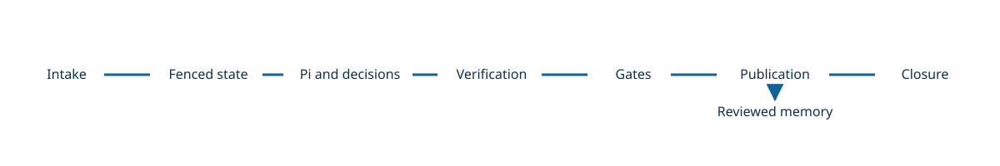

# Loopwright Architecture

Loopwright is a nine-package TypeScript harness for bounded, independently verified repository work. Its Action and App provide entry points; local evidence does not imply deployed or provider qualification.

## Contents

- [Execution chain](#execution-chain)
- [Request trace](#request-trace)
- [Core vocabulary](#core-vocabulary)

## Execution chain

<!-- flowchart LR
  intake -> state -> runtime -> verification -> gates -> publication -> closure
  runtime ..> decisions
  publication ..> memory
-->

Intake builds a TaskContract; the fenced SQLite StateStore admits work. An isolated Pi adapter executes under bounded authority, with optional System-One advice. Independent verification binds evidence to the candidate. Authenticated gates and receipts guard publication; reviewed memory and compaction follow settled outcomes. The closure matrix records the actual evidence boundary.

## Request trace

A maintainer submits a taskpack trigger. Intake validates scope and compiles trusted configuration; state reserves authority before a physical send. The adapter produces a candidate and independent checks bind their results to its digest. An authenticated gate can approve publication, whose receipt is reconciled before the run settles. Unknown effects stay unknown and are not silently retried.

## Core vocabulary

- **TaskContract**: bounded task, permissions, budgets and verification requirements.
- **Lease**: fenced ownership of mutable state; stale owners cannot authorize effects.
- **Evidence**: bound results from independent checks, not a model assertion.
- **Receipt**: authenticated result of an external effect, including uncertainty.
- **Closure**: a matrix of demonstrated capabilities and explicit gaps.

**See also**: [Module map](../README.md#module-map)

**Next**: [Action configuration](../operate/github-action.md)
